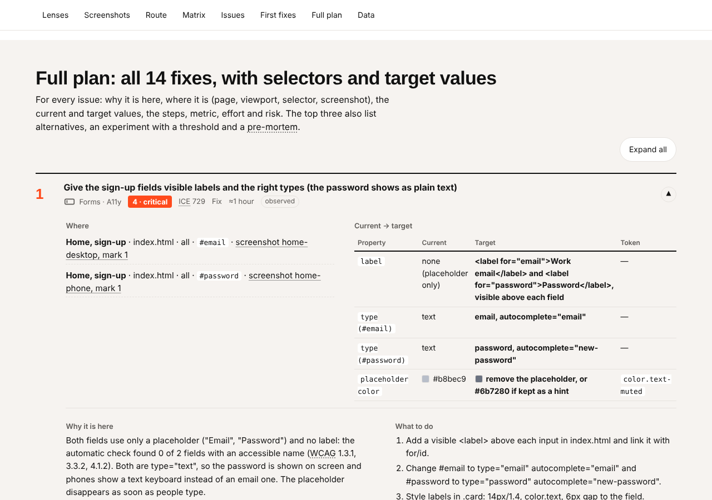

# UI Review

A Claude skill that reviews the user interface of a website, web app, SaaS screen, landing page, mobile app screenshots or Figma frames through **12 UI lenses**, and turns one review into **two outputs**:

1. **A visual report for people** - annotated screenshots with numbered marks, measured checks against targets, a lens radar, prioritized fixes and a full plan.
2. **A hands-off file for AI agents** - `handoff.md` + `tasks.json`: every fix as a task with the page, viewport, CSS selector, screenshot mark, **current → target values** (colours, sizes, spacing, tokens), steps, acceptance criteria and how to verify.

**Live demo:** [English](https://claude.ai/artifact/NwoSocJV55ttWHtgK6VZAc) · [Ukrainian](https://claude.ai/artifact/2u1RJbcn6Wa3ohBTf68yqk) (fictional invoicing app "Tallyo"; the screenshots and measurements are real, taken from [the demo page](evals/fixtures/demo-site/)). Hands-off example: [`example-handoff.en.md`](plugins/ui-review/skills/ui-review/assets/example-handoff.en.md).


### The 12 lenses

| Group | Lens | The question it asks |
|---|---|---|
| See what matters | **Visual hierarchy** | Does the eye land on the most important thing first? |
| | **Layout and spacing** | Is there one grid and one spacing scale? |
| | **Typography** | Is text easy to read at every size? |
| | **Colour and contrast** | Does colour carry meaning, and does text pass WCAG AA? |
| Get the job done | **Usability heuristics** | Does the UI follow Nielsen's 10 heuristics? |
| | **Navigation and IA** | Do people know where they are and where to go? |
| | **Forms and input** | Can people fill it in without errors? |
| | **States and feedback** | Does every action get a clear response (hover, focus, loading, empty, error)? |
| Work for everyone | **Accessibility** | Keyboard, focus, labels, alt text, landmarks, WCAG 2.2 AA |
| | **Responsive and touch** | No sideways scroll, tap targets ≥ 24 px (ideally 44), works at 360 px |
| Words that help | **Microcopy and trust** | Do buttons and errors say what happens - with no dark patterns? |
| One system | **Design-system consistency** | Are the same things made the same way, from tokens? |

### Supporting concepts

Nielsen severity (1-4), UI maturity (Broken → Usable → Consistent → Polished → Delightful), WCAG 2.2 success criteria, Gestalt, Fitts's, Hick's and Jakob's laws, squint / 5-second / first-click tests, HEART, ICE scoring, observed vs hypothesis labels, alternatives, experiment risk types and success thresholds, pre-mortem.


## What you get

- **The main problem first**, with its number, and the **UI maturity** level with what blocks the next one.
- **Measured checks, not eyeballing**: text contrast, labelled fields, visible keyboard focus, tap targets, small text - as pass counts against a target. Checks that could not run show "no data", never an invented number.
- **Annotated screenshots** at desktop and phone width: each box is an issue, red for critical or top 3; click a box to jump to its fix.
- **Issues ranked by ICE**, each with a Nielsen severity, labelled *observed* or *hypothesis*, split into fix vs rethink.
- **A full plan for every issue**: why it is there, **where** (page, viewport, selector, screenshot mark), a **current → target** table with colour swatches and tokens, steps, metric, effort and risk. The top 3 also get alternatives, an experiment with a success threshold, a pre-mortem and copy variants.
- **Tooltips for every term** (WCAG, AA, ICE, tap target, token...): hover on desktop, tap on phone or tablet.
- **The same report design** as [product-lens-audit](https://github.com/artemhorbenko/product-lens-audit): annual-report look, light and dark, Sofia Sans, one vermilion accent, stacked tables on phones, Ukrainian and English.

<p>


</p>

## How it works

1. **Checks connected sources** - browser, a shell with Playwright, Figma or design tokens, Clarity / Hotjar, feedback - and marks each as used, partial or missing.
2. **Asks up to 4 quick questions**, each one skippable: key screens and task, devices, design system and constraints, what is already known.
3. **Opens each key screen** at desktop 1280×800 and phone 390×844 and walks the main task. With a shell, `scripts/inspect_ui.py` takes the screenshots, prints each element's box (for marks) and computed styles (for current values), runs the automatic checks and tabs through the page to test focus.
4. **Applies the 12 lenses**, ties every finding to a measurement or screenshot, labels it observed or hypothesis, and prioritizes with severity and ICE. Top 3: alternatives, threshold, pre-mortem.
5. **Writes one `audit.json`**, validates it (`scripts/validate_audit.py`: every issue has evidence and a location, every number a source, every mark a real issue, the top 3 have alternatives and a pre-mortem), builds the page with screenshots embedded (`scripts/build_report.py`), then **checks that it renders** on desktop, tablet and phone (`scripts/check_report.py`). Claude writes only data; the template draws everything.
6. **Writes the hands-off file** (`scripts/build_handoff.py`): context, sources, design tokens, rules for the implementer, and every issue as a task ordered by ICE with dependencies first.

## Install

### Claude Code (terminal, desktop app, VS Code)

```
/plugin marketplace add artemhorbenko/ui-review
/plugin install ui-review@ui-review
```

Then ask, for example: *"Review the UI of example.com/signup on desktop and phone, and give me a task file for my coding agent"*.

### Claude app (claude.ai, desktop, mobile)

1. Download `ui-review-skill.zip` from this repository ([direct download](https://github.com/artemhorbenko/ui-review/raw/main/ui-review-skill.zip)).
2. Make sure code execution is on (Free, Pro, Max: Settings → Capabilities).
3. Go to **Customize → Skills**, click **+**, then **Create skill → Upload a skill**, and choose the ZIP.

See Anthropic's guide: [Use skills in Claude](https://support.claude.com/en/articles/12512180-use-skills-in-claude). Skills you enable in Claude also load in Claude Code when you sign in with the same account.

### Any other agent that reads SKILL.md

Copy `plugins/ui-review/skills/ui-review/` into your agent's skills folder.

## Better results with data

The skill works with just a URL or screenshots, but measurements make the plan exact. Connect what you have, read-only:

| Input | Options |
|---|---|
| Browser | Claude in Chrome, the built-in browser, or Playwright from the shell (`inspect_ui.py`) |
| Design source | Figma (Dev Mode variables), Storybook, your tokens / Tailwind config / theme file |
| Behaviour | Microsoft Clarity, Hotjar, PostHog, GA4 events - rage clicks, scroll depth, field drop-off |
| Feedback | Support tickets, app store reviews, usability-test notes |
| Checkers | axe, Lighthouse, Pa11y - if you already run them |

## Run the scripts yourself

```
S=plugins/ui-review/skills/ui-review
pip install playwright && playwright install chromium
python $S/scripts/inspect_ui.py https://example.com --name home --sel cta=".hero .btn" --out shots
python $S/scripts/validate_audit.py audit.json          # standard library only
python $S/scripts/build_report.py audit.json report.html
python $S/scripts/build_handoff.py audit.json handoff.md --json tasks.json
python $S/scripts/check_report.py report.html --out ./report-check
```

Start from `$S/assets/example-audit.en.json`; the shape is in `$S/references/audit.schema.json`. `inspect_ui.py` only loads and reads pages: it never clicks, types or submits anything.

## Privacy and safety

- Sources are used read-only. The skill does not submit forms, payments or messages on the interface it reviews.
- It never invents measurements, analytics, user quotes or testimonials, and it flags dark patterns instead of recommending them.
- The report is one self-contained HTML file with the screenshots embedded; nothing is sent anywhere by the report itself. Remove private data from screenshots before sharing it.

## Repository layout

```
.claude-plugin/marketplace.json        marketplace catalog (this repo)
plugins/ui-review/
  .claude-plugin/plugin.json
  skills/ui-review/
    SKILL.md                           the process
    references/lenses.md               the 12 lenses, severity, UI maturity
    references/data-sources.md         what to measure in each source, fallbacks
    references/report-spec.md          report sections, marks, tooltips, mobile rules
    references/audit.schema.json       shape of the report data
    assets/report-template.html        the report page; renders from one JSON block
    assets/example-audit.json          full example in Ukrainian (fictional "Tallyo")
    assets/example-audit.en.json       the same in English
    assets/example-handoff.en.md       the hands-off file built from it
    assets/demo/                       the demo screenshots
    scripts/inspect_ui.py              screenshots, element boxes, computed styles, automatic checks
    scripts/validate_audit.py          data and rule check
    scripts/build_report.py            audit.json -> report.html (screenshots embedded)
    scripts/check_report.py            headless render check
    scripts/build_handoff.py           audit.json -> handoff.md (+ tasks.json) for AI agents
evals/                                 scenarios, trigger prompts, results log, demo site fixture
docs/                                  screenshots
ui-review-skill.zip                    the skill packaged for upload to the Claude app
```

## Credits

The skill borrows ideas, not text, from: Jakob Nielsen's 10 usability heuristics and severity ratings; W3C WCAG 2.2; Gestalt principles; Fitts's, Hick's and Jakob's laws; HEART (Google); the opportunity solution tree and experiment framing (Teresa Torres, Paweł Huryn); the report design, process and hands-off format of [product-lens-audit](https://github.com/artemhorbenko/product-lens-audit).

## License

MIT - see [LICENSE](LICENSE).

---

## Українською

**UI Review** - скіл для Claude, який робить рев'ю інтерфейсу сайту, вебзастосунку, SaaS-екрана, лендингу, скріншотів мобільного застосунку чи фреймів Figma через **12 UI-лінз** і з одного рев'ю видає **два результати**:

1. **Візуальний звіт для людей** - скріншоти з пронумерованими позначками, виміряні перевірки проти цілей, радар лінз, пріоритезовані виправлення й повний план.
2. **Hands-off файл для AI-агентів** - `handoff.md` + `tasks.json`: кожне виправлення як задача зі сторінкою, в'юпортом, CSS-селектором, позначкою на скріншоті, **значеннями «зараз → ціль»** (кольори, розміри, відступи, токени), кроками, критеріями приймання й способом перевірки.

**Демо-звіт:** [українською](https://claude.ai/artifact/2u1RJbcn6Wa3ohBTf68yqk) · [англійською](https://claude.ai/artifact/NwoSocJV55ttWHtgK6VZAc) (вигаданий застосунок для рахунків «Tallyo»; скріншоти й виміри справжні, зняті з [демо-сторінки](evals/fixtures/demo-site/)).

**12 лінз у 5 групах:**
- **Видно головне:** візуальна ієрархія, сітка й відступи, типографіка, колір і контраст (WCAG AA).
- **Задача виконується:** евристики Нільсена, навігація, форми, стани й зворотний зв'язок.
- **Працює для всіх:** доступність (клавіатура, фокус, підписи, WCAG 2.2), адаптивність і зони дотику.
- **Слова допомагають:** мікрокопі й довіра, без dark patterns.
- **Одна система:** цілісність дизайн-системи й токенів.

**Як працює:** перевіряє підключені джерела → ставить до 4 питань (кожне можна пропустити) → відкриває ключові екрани на desktop і телефоні, `inspect_ui.py` знімає скріншоти, рамки елементів, обчислені стилі та запускає автоматичні перевірки (контраст, підписи полів, видимий фокус, зони дотику, дрібний текст, горизонтальна прокрутка) → знахідки з позначкою «спостережено / гіпотеза» на анотованих скріншотах → серйозність і ICE → топ-3 з альтернативами, порогом і pre-mortem → `audit.json` → звіт і hands-off файл. Claude пише лише дані; шаблон малює все сам і показує «немає даних» замість вигаданих чисел.

Встановлення в Claude Code:

```
/plugin marketplace add artemhorbenko/ui-review
/plugin install ui-review@ui-review
```

Для Claude app завантажте ZIP з репозиторію ([пряме завантаження](https://github.com/artemhorbenko/ui-review/raw/main/ui-review-skill.zip)), потім **Customize → Skills → + → Create skill → Upload a skill**. Потрібне ввімкнене виконання коду.

Ліцензія MIT.
