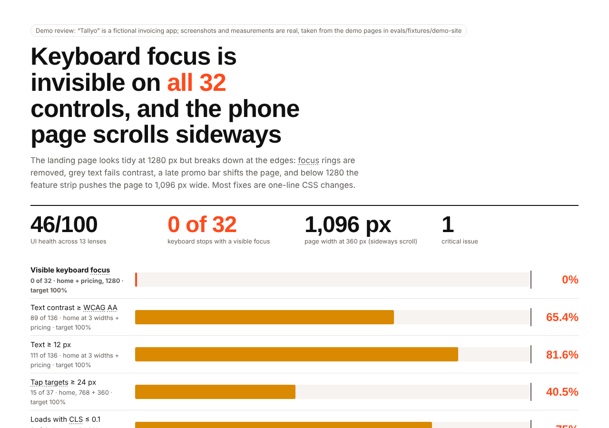
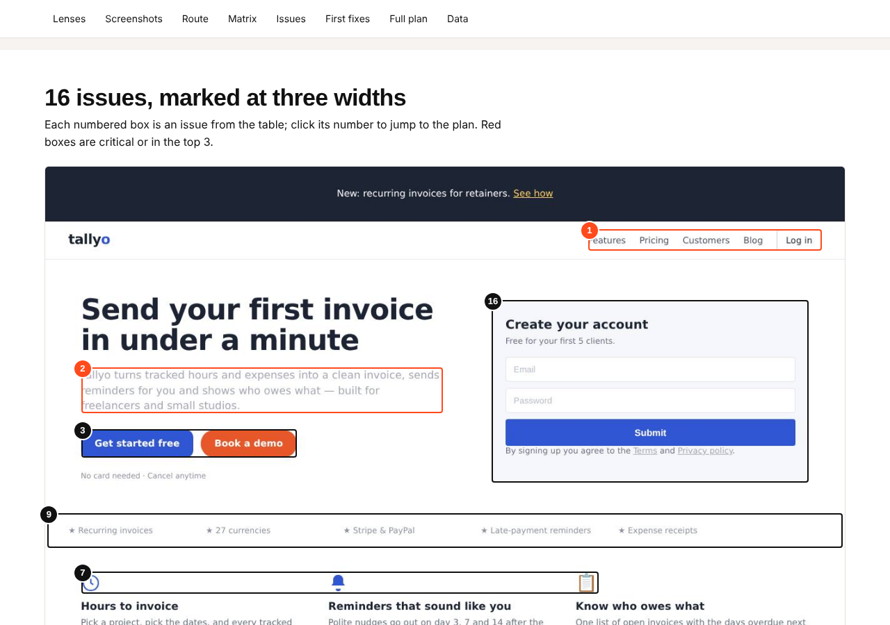
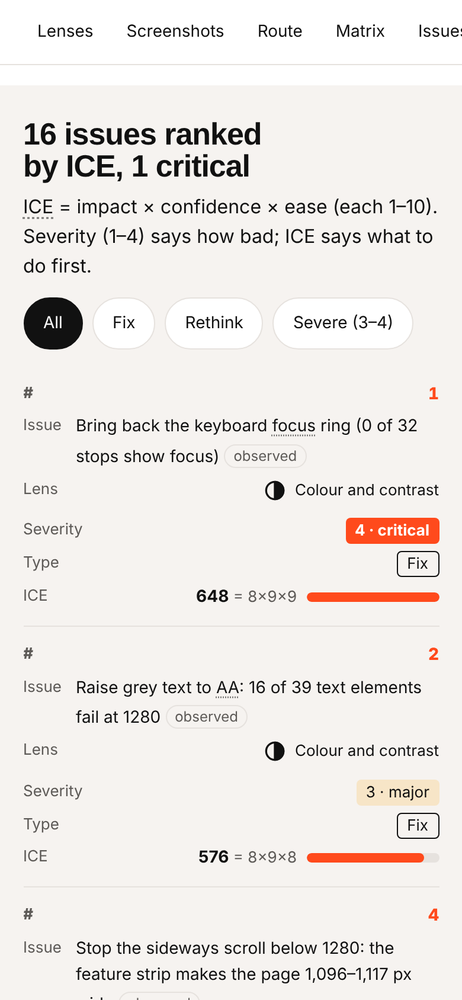

# UI Review

A Claude skill that reviews the **visual interface** of a website, web app, landing page, mobile app screenshots or Figma frames through **13 UI lenses**, measured at **360, 768 and 1280 px**, and turns one review into **two outputs**:

1. **A visual report for people** - annotated screenshots at three widths with numbered marks, measured checks against targets, a lens radar, prioritized fixes and a full plan.
2. **A hands-off file for AI agents** - `handoff.md` + `tasks.json`: every fix as a task with the page, viewport, CSS selector, screenshot mark, **current → target values** (colours, sizes, spacing, tokens), steps, acceptance criteria and how to verify.

**Live demo:** [English report](https://claude.ai/artifact/NwoSocJV55ttWHtgK6VZAc) (fictional invoicing app "Tallyo"; screenshots and measurements are real, taken from [the demo pages](evals/fixtures/demo-site/)). Hands-off example: [`example-handoff.en.md`](plugins/ui-review/skills/ui-review/assets/example-handoff.en.md). The report interface also speaks Ukrainian (`"lang": "uk"`).

**Scope.** Looks and surface behaviour only. Task flows, forms logic, navigation and copy belong to **ux-review**; strategy and growth to [product-lens-audit](https://github.com/artemhorbenko/product-lens-audit). Out-of-scope observations get one line in the report with a pointer, not an issue.



### The 13 lenses

| Group | Lens | What is measured |
|---|---|---|
| Where the eye goes | **Visual hierarchy** | Heading steps, one dominant element per screen, squint test |
| | **CTA prominence** | Size, colour, contrast and position of the primary action at every width |
| | **Imagery and icons** | One icon style, image quality and crops, named icon links, icon contrast ≥ 3:1 |
| Underlying order | **Layout and grid** | Content width, columns, alignment between sections, line length |
| | **Spacing rhythm** | Distinct spacing values and how many sit on a 4 px scale |
| | **Typography scale** | Distinct sizes and weights, step ratio, body size and line height, nothing under 12 px |
| Colour and brand | **Colour and contrast** | WCAG 2.2 AA for text, large text, UI parts, focus rings |
| | **Dark mode** | `prefers-color-scheme` rules and an emulated dark screenshot, if the product has one |
| | **Brand coherence** | Off-palette colours, logo use, one type family, consistent image style |
| One system | **Design-system consistency** | Variants of buttons, radii, shadows, greys; values that match no token |
| Across widths and time | **Responsive behaviour** | Sideways scroll, clipping, tap targets ≥ 24 / 44 px, fixed bars as a share of the screen |
| | **Motion** | Infinite or autoplay animation, `prefers-reduced-motion` support |
| | **Perceived performance** | CLS, LCP (on your connection), loading states |

Supporting concepts: Nielsen severity (1-4), UI maturity (Broken → Usable → Consistent → Polished → Delightful), WCAG 2.2 success criteria, Gestalt, Fitts's law, modular type scale, ICE scoring, observed vs hypothesis labels, alternatives, experiment risk types and success thresholds, pre-mortem.



## How it works

1. **Checks sources** - a shell with Playwright, a browser tool, Figma or design tokens, analytics - and marks each as used (`ok`), partial (`demo`) or missing (`no`).
2. **Asks up to 4 quick questions**, each skippable: key pages, devices and dark mode, design system and brand, what is already known.
3. **Measures every key page at 360, 768 and 1280 px.** `scripts/probe.js` reads computed styles, element boxes, contrast over the whole page, the type / colour / radius / spacing scale in use, tap targets, dark-mode and reduced-motion rules, running animations, CLS and LCP. `scripts/inspect_ui.py` runs it with Playwright, saves screenshots, emulates dark mode and reduced motion and tabs through for visible focus. Without a shell, paste `probe.js` into a browser tool; for exact widths, load the page in a same-origin iframe of that size.
4. **Applies the 13 lenses**, labels every finding observed or hypothesis, marks it on the screenshots, and prioritizes with severity and ICE. Top 3: alternatives, success threshold, pre-mortem.
5. **Writes one `audit.json`** → `validate_audit.py` (evidence, location, sources, marks, top-3 rules; warns when a width is missing) → `build_report.py` (screenshots embedded) and `build_handoff.py` → `check_report.py` (render check at desktop, tablet and phone) → **fact check**: every number traced to the probe output, every mark on its element.

## What you get

- **The main problem first**, with its number, and the **UI maturity** level.
- **Measured checks, not eyeballing**: contrast, named icon links, visible focus, tap targets, small text, layout shift - pass counts against targets, "no data" when a check could not run.
- **Annotated screenshots at three widths**; click a mark to jump to its fix.
- **Issues ranked by ICE** with severity, split into fix vs rethink, each with **where** (page, width, selector, mark) and a **current → target** table with colour swatches and tokens.
- **The same report design** as product-lens-audit: annual-report look, light and dark, Sofia Sans, one vermilion accent, tooltips for every term, stacked tables on phones, English and Ukrainian.

<p>


</p>

## Install

### Claude Code (terminal, desktop app, VS Code)

```
/plugin marketplace add artemhorbenko/ui-review
/plugin install ui-review@ui-review
```

Then ask, for example: *"Review the UI of example.com and /pricing at 360, 768 and 1280, and give me a task file for my coding agent"*.

### Claude app (claude.ai, desktop, mobile)

1. Download `ui-review-skill.zip` from this repository ([direct download](https://github.com/artemhorbenko/ui-review/raw/main/ui-review-skill.zip)).
2. Make sure code execution is on (Settings → Capabilities).
3. Go to **Customize → Skills**, click **+**, then **Create skill → Upload a skill**, and choose the ZIP.

See Anthropic's guide: [Use skills in Claude](https://support.claude.com/en/articles/12512180-use-skills-in-claude).

### Any other agent that reads SKILL.md

Copy `plugins/ui-review/skills/ui-review/` into your agent's skills folder.

## Run the scripts yourself

```
S=plugins/ui-review/skills/ui-review
pip install playwright && playwright install chromium
python $S/scripts/inspect_ui.py https://example.com --name home --sel cta=".hero .btn" --out shots
python $S/scripts/validate_audit.py audit.json          # standard library only
python $S/scripts/build_report.py audit.json report.html
python $S/scripts/build_handoff.py audit.json handoff.md --json tasks.json
python $S/scripts/check_report.py report.html --out ./report-check
```

Start from `$S/assets/example-audit.en.json`; the shape is in `$S/references/audit.schema.json`. The probe only loads and reads pages: it never clicks, types or submits anything.

## Privacy and safety

- Sources are used read-only; the skill does not submit forms, sign up, pay or send messages.
- It never invents measurements, analytics or quotes, and it does not recommend dark patterns.
- The report is one self-contained HTML file with the screenshots embedded. Remove private data from screenshots before sharing.

## Repository layout

```
.claude-plugin/marketplace.json        marketplace catalog (this repo)
plugins/ui-review/
  .claude-plugin/plugin.json
  skills/ui-review/
    SKILL.md                           the process
    references/lenses.md               the 13 lenses, what to measure, severity, UI maturity
    references/data-sources.md         what to measure in each source, fallbacks, the iframe method
    references/report-spec.md          report sections, marks, tooltips, mobile rules
    references/audit.schema.json       shape of the report data
    assets/report-template.html        the report page; renders from one JSON block
    assets/example-audit.en.json       full example (fictional "Tallyo")
    assets/example-handoff.en.md       the hands-off file built from it
    assets/demo/                       demo screenshots at 360, 768, 1280
    scripts/probe.js                   the measuring probe (browser or Playwright)
    scripts/inspect_ui.py              screenshots at 3 widths + probe + dark/reduced-motion/focus
    scripts/validate_audit.py          data and rule check
    scripts/build_report.py            audit.json -> report.html (screenshots embedded)
    scripts/check_report.py            headless render check
    scripts/build_handoff.py           audit.json -> handoff.md (+ tasks.json) for AI agents
evals/                                 scenarios, trigger prompts, results log, demo site fixture
docs/                                  screenshots
ui-review-skill.zip                    the skill packaged for upload to the Claude app
```

## Credits

Ideas, not text, from: W3C WCAG 2.2; Jakob Nielsen's severity ratings; Gestalt principles; Fitts's law; modular scale; Core Web Vitals (CLS, LCP); the opportunity solution tree and experiment framing (Teresa Torres, Paweł Huryn); the report design, process and hands-off format of [product-lens-audit](https://github.com/artemhorbenko/product-lens-audit).

## License

MIT - see [LICENSE](LICENSE).

---

## Українською

**UI Review** - скіл для Claude, який робить рев'ю **візуального інтерфейсу** сайту, вебзастосунку, лендингу, скріншотів мобільного застосунку чи фреймів Figma через **13 UI-лінз** на ширинах **360, 768 і 1280 px** і з одного рев'ю видає **два результати**:

1. **Візуальний звіт для людей** - скріншоти на трьох ширинах із пронумерованими позначками, виміряні перевірки проти цілей, радар лінз, пріоритезовані виправлення й повний план.
2. **Hands-off файл для AI-агентів** - `handoff.md` + `tasks.json`: кожне виправлення як задача зі сторінкою, в'юпортом, CSS-селектором, позначкою на скріншоті, значеннями **«зараз → ціль»**, кроками, критеріями приймання й способом перевірки.

**Демо-звіт:** [англійською](https://claude.ai/artifact/NwoSocJV55ttWHtgK6VZAc) (вигаданий застосунок «Tallyo», справжні виміри демо-сторінок). Інтерфейс звіту підтримує українську (`"lang": "uk"`).

**Межі.** Лише вигляд і поведінка поверхні. Сценарії, форми, навігація й тексти - це **ux-review**, стратегія й ріст - **product-lens-audit**.

**13 лінз у 5 групах:**
- **Куди йде погляд:** візуальна ієрархія, помітність CTA, зображення й іконки.
- **Внутрішній порядок:** сітка, ритм відступів, шкала типографіки.
- **Колір і бренд:** колір і контраст (WCAG), темна тема, цілісність бренду.
- **Одна система:** відповідність власній дизайн-системі.
- **На різних ширинах і в часі:** адаптивність (360/768/1280), анімація, відчутна швидкість (CLS, LCP).

**Як працює:** джерела (ok / demo / no) → до 4 питань, кожне можна пропустити → виміри `probe.js` на трьох ширинах (обчислені стилі, контраст усієї сторінки, шкали шрифтів, кольорів, радіусів і відступів, зони дотику, правила темної теми й reduced motion, анімації, CLS, LCP) → знахідки «спостережено / гіпотеза» на анотованих скріншотах → серйозність і ICE → топ-3 з альтернативами, порогом і pre-mortem → валідація → звіт і hands-off → перевірка рендеру → фактчек.

Встановлення в Claude Code:

```
/plugin marketplace add artemhorbenko/ui-review
/plugin install ui-review@ui-review
```

Для Claude app завантажте ZIP з репозиторію ([пряме завантаження](https://github.com/artemhorbenko/ui-review/raw/main/ui-review-skill.zip)), потім **Customize → Skills → + → Create skill → Upload a skill**. Потрібне ввімкнене виконання коду.

Ліцензія MIT.
